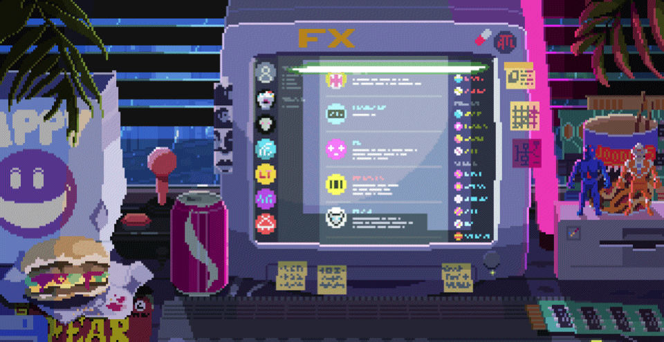

<table>
<tr>
<td width="70%" valign="middle">

</td>
<td width="30%" align="center" valign="middle">

</td>
</tr>
</table>

| PROJECT | ENGINEERING HIGHLIGHT |
| :--- | :--- |
| **[MCP / Meeting Room Reservations](https://github.com/Anggelie/MCP-local-Gesti-n-de-reservas-de-salas-de-reuniones)** | `MCP` `JSON-RPC` `HTTP` |
| **[MCP / Local Server](https://github.com/Anggelie/mcp-local-server-uvg)** | `Python` `Protocol design` |
| **[Fuzzy Logic / Ventilation](https://github.com/Anggelie/Proyecto-L-gica-Fuzzy-con-Python)** | `AI` `Streamlit` `scikit-fuzzy` |
| **[Turing Machine Simulator](https://github.com/Anggelie/Simulador-Maquina-de-Turing)** | `Python` `Automata` |
| **[Turing Machine / Project 3](https://github.com/Anggelie/Teoria-Computacion-Proyecto-3)** | `YAML` `Validation` |
| **[Rasterization](https://github.com/Anggelie/Rasterization)** | `Graphics` `Rendering` |

---

BUILD • BREAK • LEARN • REPEAT

